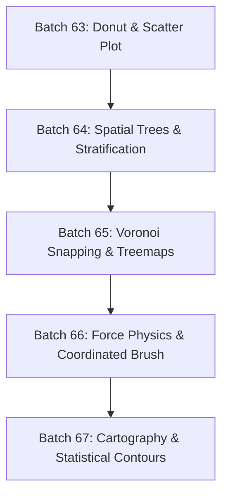

# D3 Data Visualization & Advanced Algorithms Expansion Plan

## 1. Vision & Architectural Philosophy

The **D3 track** in the Leitner Coding Trainer drills both **production SVG visualization engineering** (margin conventions, scales, axes, responsive layouts, React hooks lifecycle) and **D3's underlying computational engines** (spatial indexing, tree transformations, computational geometry, force physics simulations, and coordinate projections).

### Core Principles
1. **D3 is an Algorithmic Engine, Not Just SVG Shapes:**  
   Advanced technical interviews assess deep understanding of data structures: spatial trees (`d3.quadtree`), hierarchical stratifications (`d3.stratify`), Delaunay/Voronoi graphs (`d3.Delaunay`), and discrete numerical approximations (`d3.forceSimulation`).
2. **Deterministic, Headless & Sandbox Tested:**  
   Every card has concrete unit/contract tests, a strict TypeScript interface, canonical `.ref.js` and `.ref.ts` solutions, and an interactive live preview where visual feedback is valuable.
3. **Low-Token Batch Execution:**  
   Authored in strictly isolated **2-card batches** to guarantee reliable test verification, full production builds, and clean branch merging without token exhaustion.

---

## 2. Current Status (15 Cards — 100% Typed & Passing)

| Card ID | Description | Concepts / Modules | UI / Preview |
|---|---|---|---|
| `d3-react-imperative-chart` | React `useRef` + `useEffect` D3 lifecycle integration & cleanup | `d3-selection`, React DOM ref lifecycle | SVG Bar Chart in React |
| `d3-css-coordinate-layout` | CSS-driven layout calculations & DOM coordinates | `d3-selection`, CSS layout mapping | HTML Bars |
| `d3-graph-theory-visualizer` | Node-link graph SVG rendering with circular layouts | `d3-selection`, SVG line/circle paths | SVG Graph |
| `d3-svg-bar-chart` | Categorical bar chart with margin convention, scales & axes | `d3.scaleBand()`, `d3.scaleLinear()`, `d3.axisBottom/Left` | SVG Bar Chart |
| `d3-svg-line-chart` | Time/continuous line chart with curves and data dots | `d3.scaleTime()`, `d3.scaleLinear()`, `d3.line()`, axes | SVG Line Chart |
| `d3-svg-donut-chart` | Donut/pie generator with slice selection & center label | `d3.pie()`, `d3.arc()`, radial coordinates | SVG Donut Chart |
| `d3-svg-scatter-plot` | 2D continuous scatter plot with dual linear scales & radius | `d3.scaleLinear()`, `d3.extent()`, circle dot selection | SVG Scatter Plot |
| `d3-stratify-nested-hierarchy` | Flat-to-hierarchical stratification, node sum, ancestors & leaves | `d3.stratify()`, `hierarchy.sum()`, `hierarchy.leaves()` | Tree Inspector |
| `d3-quadtree-spatial-index` | 2D spatial indexing, $O(\log N)$ nearest-neighbor & radius search | `d3.quadtree()`, `quadtree.find()`, `quadtree.visit()` | Spatial Search Canvas |
| `d3-delaunay-voronoi-snapping` | 2D Delaunay triangulation & Voronoi polygon snapping cells | `d3.Delaunay.from()`, `delaunay.voronoi()`, `voronoi.renderCell()` | Interactive Voronoi SVG |
| `d3-treemap-squarified-tiling` | Squarified proportional area treemap with inner/outer padding | `d3.hierarchy()`, `d3.treemap()`, `d3.treemapSquarify` | SVG Treemap |
| `d3-force-simulation-headless` | Synchronous headless force simulation, convergence & kinetic energy | `d3.forceSimulation()`, `d3.forceManyBody()`, `d3.forceCollide()` | Force Network SVG |
| `d3-brush-zoom-coordinator` | Linked focus + context chart with 1D horizontal brush rescaling | `d3.brushX()`, `scale.invert()`, focus/context coordination | Brush & Zoom SVG |
| `d3-geo-projection-path` | Geographic spherical projection, GeoJSON paths & projected centroids | `d3.geoMercator()`, `d3.geoEquirectangular()`, `d3.geoPath()` | Cartographic Map SVG |
| `d3-contour-density-grid` | 2D kernel density estimation & marching-squares isobands | `d3.contourDensity()`, `d3.geoPath()`, `d3.scaleSequential()` | Density Isolines SVG |

---

## 3. Future Batches Roadmap (2 Cards per Batch)

---

### Batch 64: Data Stratification & Spatial Search
*Focus: Data manipulation engines and algorithmic 2D search.*

#### Card 1: `d3-stratify-nested-hierarchy`
- **Track**: `d3` | **Difficulty**: 3 (Concept: `d3-hierarchy-stratify`)
- **Category**: Non-Visual / Algorithmic Data Engine
- **Description**:  
  Accepts a flat array of relational records with parent references (`{ id: string, parentId: string | null, value?: number }`) and builds a validated `d3.hierarchy` node. Runs `.sum()`, computes node heights and depths, and returns tree metrics including total cumulative root value, node ancestors, and leaf collections.
- **Key APIs**: `d3.stratify()`, `hierarchy.sum()`, `hierarchy.leaves()`, `hierarchy.ancestors()`.
- **Harness & Verification**: Headless assertion of tree topology, root/leaf calculations, and cycle/orphan error validation.

#### Card 2: `d3-quadtree-spatial-index`
- **Track**: `d3` | **Difficulty**: 4 (Concept: `d3-quadtree-spatial`)
- **Category**: 2D Spatial Index & Search
- **Description**:  
  Constructs a 2D quadtree from a set of $(x, y)$ coordinate points using `d3.quadtree()`. Implements two core search functions:
  1. `findNearest(x, y, maxDistance)`: Retrieves the single closest point within an optional search radius in $O(\log N)$ time.
  2. `findPointsInRadius(x, y, radius)`: Uses `tree.visit(callback)` to efficiently prune and collect all points inside a circular bounding region without scanning the entire dataset.
- **Key APIs**: `d3.quadtree()`, `quadtree.find()`, `quadtree.visit()`.
- **Harness & Verification**: Headless assertion of bounding box queries, nearest-point retrieval, and pruned quad searches against synthetic point clusters.

---

### Batch 65: Computational Geometry & Area Partitioning
*Focus: Planar partitions, Voronoi hover targets, and hierarchical area layouts.*

#### Card 3: `d3-delaunay-voronoi-snapping`
- **Track**: `d3` | **Difficulty**: 4 (Concept: `d3-voronoi-geometry`)
- **Category**: Computational Geometry & Interaction
- **Description**:  
  Computes a 2D Delaunay triangulation and Voronoi tessellation (`d3.Delaunay.from()`) for a set of data coordinates. Renders an interactive SVG canvas with invisible or semi-transparent Voronoi polygon paths (`path.voronoi-cell`) mapped to each data point. Mouse movement over any Voronoi cell highlights and selects the corresponding data point even if the cursor is far from the tiny dot.
- **Key APIs**: `d3.Delaunay.from()`, `delaunay.voronoi([0, 0, width, height])`, `voronoi.renderCell(i)`.
- **Harness & Verification**: DOM checks verifying polygon path generation, bounding polygon clip bounds, and pointer-event dispatch on cell polygons.

#### Card 4: `d3-treemap-squarified-tiling`
- **Track**: `d3` | **Difficulty**: 3 (Concept: `d3-treemap-layout`)
- **Category**: Hierarchical Area Visualization
- **Description**:  
  Converts hierarchical nested data into a squarified proportional area treemap using `d3.treemap()`. Supports custom padding, round pixel borders, and inner cell text labels. Sets cell coordinates (`x0, y0, x1, y1`) and fills rectangles proportional to node value.
- **Key APIs**: `d3.treemap()`, `d3.treemapSquarify`, `hierarchy.sum()`, `hierarchy.sort()`.
- **Harness & Verification**: DOM checks on generated `<rect>` elements, bounding area sum parity, aspect ratio sanity, and non-overlapping bounds.

---

### Batch 66: Physics Simulations & Multi-View Coordination
*Focus: Numerical simulation loops and linked interactive filters.*

#### Card 5: `d3-force-simulation-headless`
- **Track**: `d3` | **Difficulty**: 4 (Concept: `d3-force-simulation`)
- **Category**: Physics Simulation Engine
- **Description**:  
  Configures a multi-body physics simulation using `d3.forceSimulation(nodes)` with `d3.forceManyBody()`, `d3.forceLink(links)`, `d3.forceCenter()`, and `d3.forceCollide(radius)`. Implements a synchronous convergence engine that halts the simulation timer (`sim.stop()`), manually steps through simulation ticks (`sim.tick(n)`), and calculates total network kinetic energy until alpha decays below target threshold.
- **Key APIs**: `d3.forceSimulation()`, `d3.forceManyBody()`, `d3.forceLink()`, `d3.forceCollide()`.
- **Harness & Verification**: Headless assertion of distance constraints between linked nodes, collision non-overlap guarantees, and deterministic coordinate settling.

#### Card 6: `d3-brush-zoom-coordinator`
- **Track**: `d3` | **Difficulty**: 4 (Concept: `d3-brush-interaction`)
- **Category**: Interactive Multi-View Coordination
- **Description**:  
  Builds a synchronized overview + detail visualization (mini-map context brush and primary focus chart). Implements `d3.brushX()` over the mini-map. When the user drags or resizes the brush window, an `onBrush` callback receives the rescaled continuous domain (`[xMin, xMax]`) and updates the focus view without full re-render.
- **Key APIs**: `d3.brushX()`, `d3.brushSelection()`, continuous scale `.invert()`.
- **Harness & Verification**: DOM checks on `.brush`, `.overlay`, `.selection`, and simulating mouse/brush drag events asserting domain callback accuracy.

---

### Batch 67: Cartographic Projections & Statistical Contours
*Focus: Spherical coordinate mathematics and continuous 2D density estimates.*

#### Card 7: `d3-geo-projection-path`
- **Track**: `d3` | **Difficulty**: 3 (Concept: `d3-geo-projection`)
- **Category**: Cartographic Mathematics & SVG Paths
- **Description**:  
  Translates spherical GeoJSON geographic features into planar SVG geometry using `d3.geoPath()` paired with `d3.geoMercator()` or `d3.geoAlbers()`. Implements feature bounding box fitting (`projection.fitSize([w, h], geojson)`), centroid computation (`geoPath.centroid(feature)`), and rendering land polygons with interactive click selection.
- **Key APIs**: `d3.geoPath()`, `d3.geoMercator()`, `projection.fitSize()`, `path.centroid()`.
- **Harness & Verification**: SVG path checks for valid path definitions (`M ... Z`), coordinate projection scaling, and centroid placement.

#### Card 8: `d3-contour-density-grid`
- **Track**: `d3` | **Difficulty**: 4 (Concept: `d3-contour-density`)
- **Category**: Continuous Statistical Geometry
- **Description**:  
  Computes continuous 2D kernel density estimations (isoline contours) from discrete point clouds using `d3.contourDensity()`. Configures bandwidth, cell size, and threshold count to generate smooth multi-polygon GeoJSON contours. Renders multi-layer elevation polygons with color scale interpolators.
- **Key APIs**: `d3.contourDensity()`, `d3.geoPath()`, `d3.scaleSequential()`.
- **Harness & Verification**: Validating generated contour threshold count, nested polygon geometries, and density values.

---

## 4. Checklist for Executing a Batch (For Resuming Agents)

When ready to implement a batch (e.g. Batch 64):
1. **Branch & Claim**:
   - `git checkout master && git pull`
   - `git checkout -b feature/d3-batch-<name>`
   - Add row to `DELEGATION.md` claim table.
2. **Card Authoring**:
   - Create 6 files per card: `.meta.json`, `.prompt.txt`, `.ref.js`, `.ref.ts`, `.harness.js`, `.preview.js`.
   - Ensure readable prompt signatures (`### fn(args): ReturnType`) with extracted `interface` blocks.
3. **Pipeline & Registration**:
   - Add concepts to `scripts/difficulty.json`.
   - Add 6 contract test cases per card in `scripts/testcases/part51.mjs`.
   - Add props panel controls in `src/lib/previewPropsConfig.ts` if `rendersComponent: true`.
   - Run `npm run build:cards && GROQ_API_KEY=unused node scripts/enrich-complexities.mjs && npm run check:cards`.
4. **Verification**:
   - `npx vitest run src/lib/seedCards.test.ts -t "<card-id>"`
   - `npx vitest run src/components/preview/reactPreviewGuard.test.ts`
   - `VITE_MUTATE=1 npm run mutation`
   - `npm run report:ts -- --check`
   - `npm run build`
   - `npx playwright test e2e/cards.spec.ts -g "<card-id>"`
5. **Documentation & Counts**:
   - Update preset counts in `src/lib/decks.ts` and `decks.test.ts`.
   - Update counts in `README.md`, `DELEGATION.md`, `ARCHITECTURE_AND_ROADMAP.md`, `ARCHITECTURE_AND_DETAILS.md`, and `TYPESCRIPT_SUPPORT_PLAN.md`.
6. **Commit & Push**:
   - Commit and push to `feature/d3-batch-<name>`. Never commit directly to `master`.
