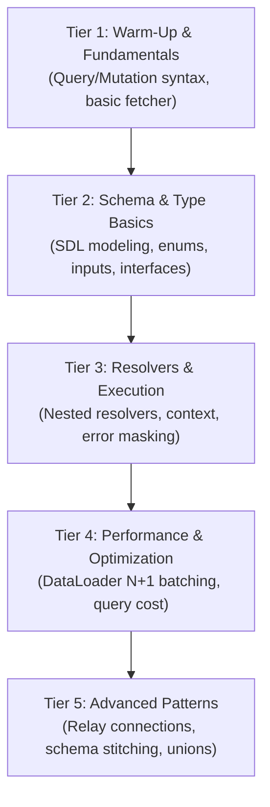

# GraphQL Curriculum & Harness Architecture

This document outlines a deliberate practice curriculum for a **GraphQL** section in the Leitner Coding Trainer, spanning cold-start retrieval of Query/Mutation design, Schema Definition Language (SDL), Resolver logic, DataLoader batching, and Client-side caching/pagination. It also answers the architectural questions regarding editor and harness support.

---

## 1. Do We Need a New Harness or Editor?

### Short Answer
**No fundamental rebuild is needed.** We can support 100% of GraphQL challenges with our existing JavaScript/TypeScript runner and CodeMirror setup with two minor, targeted enhancements:

1. **Editor Syntax Highlighting**:
   - **Recommended Approach (Zero Changes)**: Solutions and challenges can be written in idiomatic TypeScript/JavaScript using tagged template literals or comment hints (e.g. `/* GraphQL */ \`query GetUser { ... }\``), or standard JS/TS objects and functions (resolvers, schema configs, client utilities). This works immediately with our current CodeMirror JS/TS mode.
   - **Optional Enhancement**: We can add `@codemirror/lang-graphql` (or a `.graphql` mode) if we want pure raw `.graphql` document editing for SDL-only or query-only cards.

2. **Harness Environment**:
   - Our existing headless `$test` runner (`$test.run`, `$test.check`) already supports async execution and strict deep equality.
   - For resolver and schema problems, we can bundle or shim `graphql` (the official `graphql-js` library or an ambient mini-executor) into the sandbox scope, allowing cards to write:
     ```ts
     const res = await graphql({ schema, source: query, rootValue, contextValue });
     ```
   - For DataLoader challenges, the harness already provides microtask and timer assertions (`await sleep(0)`, `setTimeout`) which are ideal for testing batched calls.

---

## 2. Proposed GraphQL Curriculum & Problem Ladder

The proposed curriculum is organized across 5 difficulty tiers (Difficulty 1 to 5), covering both **client-side consumption** and **server-side schema & resolver architecture**.



---

### Tier 1: Warm-Up & Client Basics (Difficulty 1)

#### 1. `graphql-mini-client`
- **Concept**: `graphql-client`
- **Task**: Implement `fetchGraphQL(endpoint, query, variables, headers): Promise<T>` using `fetch`.
- **Invariants**:
  - Sends a `POST` request with `Content-Type: application/json`.
  - Serializes `{ query, variables }` into body.
  - Checks `res.ok`, and inspects `json.errors`: if errors exist, throws a formatted `GraphQLError` with message and locations; otherwise returns `json.data`.

#### 2. `graphql-extract-operation-name`
- **Concept**: `graphql-ast`
- **Task**: Write a utility `getOperationName(queryText: string): string | null` that extracts the top-level operation name (`query GetUserProfile`, `mutation CreateOrder`) from query source text.
- **Invariants**: Handles optional operation type keywords, anonymous queries (returns `null`), comments, and leading whitespace.

#### 3. `graphql-variable-validator`
- **Concept**: `graphql-variables`
- **Task**: Given a map of declared variable types (e.g. `{ id: 'ID!', limit: 'Int' }`) and a variables object, validate required variables (`!`) are present and non-null.

---

### Tier 2: Schema Definition & Types (Difficulty 2)

#### 4. `graphql-sdl-type-generator`
- **Concept**: `graphql-sdl`
- **Task**: Implement `generateTypeDefs(models: ModelDefinition[]): string` that outputs valid GraphQL SDL for object types, fields, scalar types, and nullability flags.
- **Invariants**: Correctly marks non-null (`!`) and array types (`[Type]!`).

#### 5. `graphql-input-object-sanitizer`
- **Concept**: `graphql-validation`
- **Task**: Implement a middleware/pre-resolver validator `validateInput(inputSchema, inputData)` that recursively strips undefined keys, enforces required fields, and validates enum values against an allowed set.

#### 6. `graphql-discriminated-union-resolver`
- **Concept**: `graphql-resolvers`
- **Task**: Implement `resolveType(value)` for a `SearchResult` union (`User | Product | Article`).
- **Invariants**: Narrows based on distinct properties (`email` -> `User`, `sku` -> `Product`, `slug` -> `Article`) and returns the `__typename` string.

---

### Tier 3: Resolvers & Execution Lifecycle (Difficulty 3) — Completed

#### 7. `graphql-nested-field-resolvers`
- **Concept**: `graphql-resolvers`
- **Task**: Construct the resolver map for an author/books relational graph:
  - `Query.authors`: returns author stubs.
  - `Author.books(parent, args, context)`: resolves books belonging to `parent.id` via context.
  - `Book.author(parent, args, context)`: resolves the author for `parent.authorId`.
- **Invariants**: Respects resolver hierarchy and does not duplicate top-level queries.

#### 8. `graphql-context-auth-guard`
- **Concept**: `graphql-middleware`
- **Task**: Write a higher-order resolver wrapper `withAuth(resolver, requiredRoles: string[])` that inspects `context.user`.
- **Invariants**: Throws `'UNAUTHENTICATED'` error if user is missing, `'FORBIDDEN'` error if user lacks role, and passes through `(parent, args, context, info)` when authorized.

#### 9. `graphql-format-error-masking`
- **Concept**: `graphql-errors`
- **Task**: Implement `formatError(error: GraphQLError): FormattedError` that sanitizes internal server errors.
- **Invariants**: Preserves validation and client errors with standard code extensions, but masks unexpected database/500 errors with `'INTERNAL_SERVER_ERROR'` and strips stack traces in non-dev environments.

---

### Tier 4: Batching & The N+1 Problem (Difficulty 4)

#### 10. `graphql-dataloader-batching`
- **Concept**: `graphql-dataloader`
- **Task**: Build a lightweight `DataLoader<K, V>` class from scratch using `queueMicrotask`:
  - `load(key: K): Promise<V>`
  - `loadMany(keys: K[]): Promise<V[]>`
  - `clear(key: K): this`
- **Invariants**:
  - Batches all keys loaded in the current tick of the event loop into a single call to `batchFn(keys)`.
  - Caches promises by key so identical keys within the batch resolve with the same reference.
  - Returns results in the exact same order as requested keys.

#### 11. `graphql-query-depth-limiter`
- **Concept**: `graphql-security`
- **Task**: Implement a query complexity depth calculator `calculateQueryDepth(queryAstOrDocument): number` that inspects nested field selections.
- **Invariants**: Ignores fragment definitions until referenced, excludes `__typename`, and throws or flags queries exceeding a `maxDepth` threshold.

#### 12. `graphql-optimistic-cache-updater`
- **Concept**: `graphql-client-cache`
- **Task**: Implement an Apollo-style normalized cache updater `updateItemInCache(cache, typeName, id, updateFn)` that updates a normalized store formatted as `Record<string, NormalizedEntity>`.
- **Invariants**: Immutably updates the target entity (`TypeName:id`), leaves other records untouched, and handles missing keys gracefully.

---

### Tier 5: Advanced Architectures & Standards (Difficulty 5)

#### 13. `graphql-relay-connection-builder`
- **Concept**: `graphql-pagination`
- **Task**: Implement `buildRelayConnection(items, { first, after, last, before }): Connection<T>`:
  - Encodes and decodes base64 cursors (`cursor: base64(index)`).
  - Computes `pageInfo: { hasNextPage, hasPreviousPage, startCursor, endCursor }`.
  - Slices array according to cursor boundaries and limits.
- **Invariants**: Meets the official Relay Cursor Connections Specification invariants and boundary conditions.

#### 14. `graphql-schema-stitching-merger`
- **Concept**: `graphql-federation`
- **Task**: Implement a schema boundary merger `mergeResolvers(...resolverMaps)` that merges multiple subsystem resolver maps into a single unified root, detecting and throwing on conflicting field definitions while cleanly merging nested type extensions.

---

## 3. Comparison & Integration Summary

| Aspect | Current Infrastructure | Required for GraphQL |
|---|---|---|
| **Editor** | CodeMirror 6 (JavaScript/TypeScript/JSX) | Existing editor works 100% using TS/JS functions & tagged literals. |
| **Harness** | Async `$test.run`, strict deep equality, timer control | Existing harness handles async resolvers, microtasks, and client requests. |
| **New Track** | `react`, `typescript-patterns`, `algorithms`, etc. | Add `'graphql'` to `TrackType` in `src/lib/leitner.ts` and track filter bar. |
| **Dependencies** | Sucrase, Prettier standalone | Optional: `graphql-js` (or lightweight mock execution harness). |
